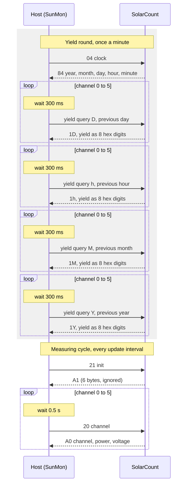
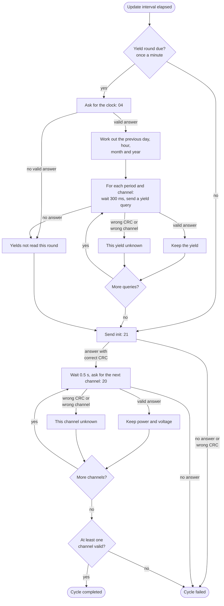
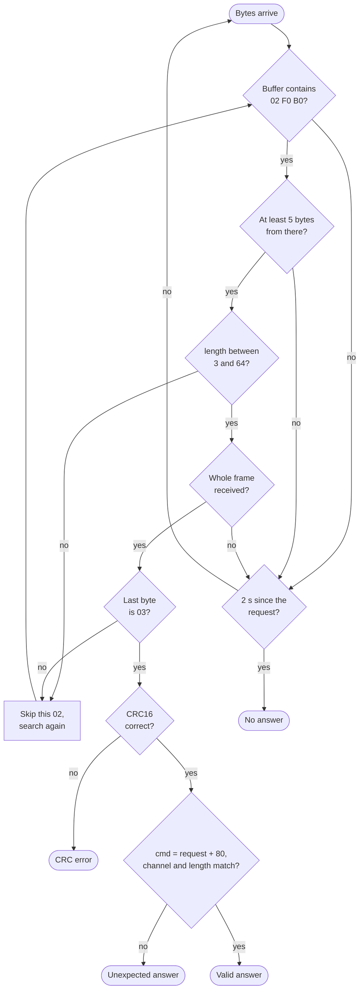
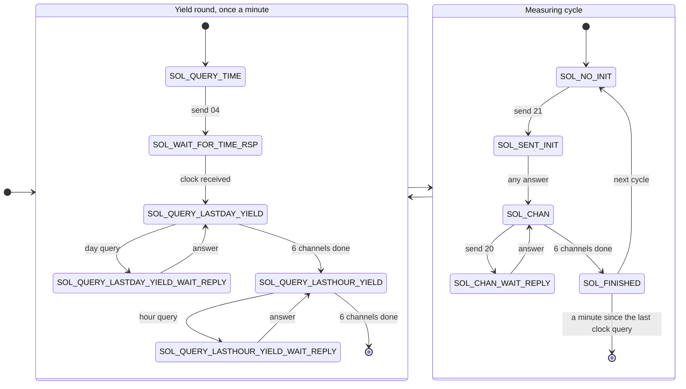

# SolarCount UART protocol

How SunMon talks to a SolarCount over RS485. It was worked out from the
firmware of a data logger that reads a SolarCount,
[firmware/SolarCountUART.c](../firmware/SolarCountUART.c), and is implemented in
[custom_components/sunmon/api.py](../custom_components/sunmon/api.py).

The SolarCount speaks two kinds of frames on the same line:

- **binary frames** for the init, the clock and the live channel values
- **text frames** for the yields (the energy of a past hour, day, month or year)

All example frames below are real captures or were computed with SunMon's own
code, so their checksums are correct.

## Line settings

| Setting | Value |
| --- | --- |
| Interface | RS485, two wires (A and B), half duplex |
| Speed | 57600 baud |
| Format | 8 data bits, no parity, 1 stop bit (8N1) |
| Capacity | 5760 bytes per second for both directions together |
| Roles | the host asks, the SolarCount answers; it never sends on its own |

Because RS485 is half duplex, the line can deliver a stray `00` when the
direction switches, and some USB adapters echo the bytes they send. A receiver
has to skip such bytes in front of a frame.

## Binary frames

### Layout

```
 offset   0      1      2      3      4      5      6 … n-4    n-3    n-2    n-1
        ┌──────┬──────┬──────┬─────────────┬──────┬─────────┬─────────────┬──────┐
        │ STX  │ dest │ src  │   length    │ cmd  │  data   │   CRC16     │ ETX  │
        │  02  │      │      │ low   high  │      │ 0…n B   │ low   high  │  03  │
        └──────┴──────┴──────┴─────────────┴──────┴─────────┴─────────────┴──────┘
                └──────────────── covered by the CRC16 ───────┘
                                    └──── counted by length ──────────────┘
```

| Field | Size | Meaning |
| --- | --- | --- |
| STX | 1 | always `02` |
| dest | 1 | address of the receiver: `B0` = SolarCount, `F0` = host |
| src | 1 | address of the sender |
| length | 2 | number of bytes from cmd up to and including the CRC, low byte first |
| cmd | 1 | command; an answer repeats the command with the top bit set (`20` → `A0`) |
| data | 0 or more | depends on the command |
| CRC16 | 2 | CRC-16/CCITT over dest up to the end of data, low byte first |
| ETX | 1 | always `03` |

A request therefore starts with `02 B0 F0` and an answer with `02 F0 B0`. The
whole frame is `length + 6` bytes long.

### Commands

| Command | Answer | Request data | Answer data | Purpose |
| --- | --- | --- | --- | --- |
| `21` | `A1` | `00` | 6 bytes, meaning unknown | init; starts every measuring cycle |
| `20` | `A0` | channel `00`…`05` | 7 bytes: channel, power, voltage | live values of one channel |
| `04` | `84` | none | 5 bytes: year, month, day, hour, minute | the SolarCount's clock |

### Init (command 21)

```
request   02 B0 F0 04 00 21 00 CC 35 03
          │  │  │  └───┘ │  │  └───┘ └ ETX
          │  │  │  len 4 │  │  CRC 35CC
          │  │  │        │  └ data 00
          │  │  │        └ cmd 21 (init)
          │  │  └ src F0 (host)
          │  └ dest B0 (SolarCount)
          └ STX

answer    02 F0 B0 09 00 A1 FD 03 00 00 00 00 07 21 03
                   └───┘ │  └───────────────┘ └───┘
                   len 9 │  6 data bytes      CRC 2107
                         └ A1 = answer to 21
```

The meaning of the six data bytes is not known. The firmware accepts any answer
to the init. SunMon accepts any answer with a correct checksum, even one with
another command.

### Channel values (command 20)

Request for channel 1 (the second channel, shown as "Channel 2" in Home
Assistant):

```
request   02 B0 F0 04 00 20 01 DC 16 03
                         │  └ channel 01
                         └ cmd 20
```

Answer:

```
 offset   0  1  2  3  4  5  6  7  8  9  10 11 12 13 14 15
        ┌──┬──┬──┬─────┬──┬──┬─────┬─────┬──┬──┬─────┬──┐
        │02│F0│B0│0A 00│A0│01│87 00│00 00│EC│00│F2 3F│03│
        └──┴──┴──┴─────┴──┴──┴─────┴─────┴──┴──┴─────┴──┘
         STX dest src len  cmd ch  power  ?    U  ?  CRC  ETX
```

| Offset | Field | Example | Meaning |
| --- | --- | --- | --- |
| 6 | channel | `01` | must match the channel that was asked for |
| 7–8 | power | `87 00` | watts, 16 bit, low byte first: `0x0087` = **135 W** |
| 9–10 | unknown | `00 00` | always zero so far |
| 11 | voltage | `EC` | volts, 8 bit: `0xEC` = **236 V** |
| 12 | unknown | `00` | always zero so far |

The answer is always 16 bytes long (length field `0A 00`). SunMon rejects a
channel answer of any other length as unexpected, even with a correct CRC.

The firmware keeps the power unsigned. SunMon reads it as signed
(−32768…32767 W), so a negative power arrives as a negative number.

### Clock (command 04)

```
request   02 B0 F0 03 00 04 AB B9 03

answer    02 F0 B0 08 00 84 09 0C 04 0A 26 86 CD 03
                         │  │  │  │  │  └ minute 0x26 = 38
                         │  │  │  │  └ hour 0x0A = 10
                         │  │  │  └ day 4
                         │  │  └ month 0x0C = 12
                         │  └ year 9 = 2009 (two digits)
                         └ 84 = answer to 04
```

The values are plain binary numbers, not BCD. This capture says
4 December 2009, 10:38. The clock is only used to work out which past day,
hour, month and year to ask for in the yield queries.

### CRC-16/CCITT

Start value `FFFF`, over every byte from dest to the end of data. The result is
sent low byte first.

```python
def crc16(data: bytes) -> int:
    crc = 0xFFFF
    for byte in data:
        crc = ((crc >> 8) | (crc << 8)) & 0xFFFF
        crc ^= byte
        crc ^= (crc & 0xFF) >> 4
        crc ^= (crc << 12) & 0xFFFF
        crc ^= ((crc & 0xFF) << 5) & 0xFFFF
    return crc
```

Example: `crc16(B0 F0 04 00 21 00)` = `0x35CC`, sent as `CC 35`.

## Text frames for the yields

The yields use a different frame made of printable ASCII characters, with its
own address and checksum.

### Request

```
 offset   0     1     2     3      4     5     6     7     8     9     10    11
        ┌─────┬─────┬─────┬──────┬─────┬─────┬─────┬─────┬───────────┬─────┬─────┐
        │ STX │ '1' │ '<' │period│ '0' │ ch  │ '0' │ '0' │  value    │CRC8 │ ETX │
        │ 02  │ 31  │ 3C  │      │ 30  │30…35│ 30  │ 30  │ 2 digits  │     │ 03  │
        └─────┴─────┴─────┴──────┴─────┴─────┴─────┴─────┴───────────┴─────┴─────┘
              └───────────────── covered by the CRC8 ──────────────────┘
```

| Field | Meaning |
| --- | --- |
| `'1'` | unit address of the SolarCount |
| `'<'` | "query" |
| period | `'D'` day, `'h'` hour, `'M'` month, `'Y'` year |
| ch | channel as a digit, `'0'`…`'5'` |
| value | which day, hour, month or year, as two ASCII digits (see below) |

How the value is written depends on the period:

| Period | Value | Digits | Example |
| --- | --- | --- | --- |
| `D` day | day of the month, 1–31 | hex | day 10 → `0A` |
| `h` hour | hour, 0–23 | hex | hour 13 → `0D` |
| `M` month | month, 1–12 | decimal (BCD) | October → `10` |
| `Y` year | last two digits of the year | decimal (BCD) | 2025 → `25` |

Examples, all for channel 0:

| Query | Frame | Between STX and CRC |
| --- | --- | --- |
| day 10 | `02 31 3C 44 30 30 30 30 30 41 C9 03` | `1<D00000A` |
| hour 13 | `02 31 3C 68 30 30 30 30 30 44 9C 03` | `1<h00000D` |
| October | `02 31 3C 4D 30 30 30 30 31 30 E7 03` | `1<M000010` |
| 2025 | `02 31 3C 59 30 30 30 30 32 35 82 03` | `1<Y000025` |

### Response

```
 offset   0     1     2      3 … 8                9 … 16                  17    18    19
        ┌─────┬─────┬──────┬───────────────────┬───────────────────────┬─────┬─────┬─────┐
        │ STX │ '1' │period│ the 6 characters  │ yield: 8 hex digits   │CRC8 │ ETX │ ETX │
        │ 02  │ 31  │      │ of the request    │                       │     │ 03  │ 03  │
        └─────┴─────┴──────┴───────────────────┴───────────────────────┴─────┴─────┴─────┘
              └──────────────────── covered by the CRC8 ────────────────┘
```

The response repeats the period in place of `'<'`, then the six characters
`'0' ch '0' '0' value` of the request, so a receiver can check that it answers
the right question. It ends with **two** ETX.

A real capture from the firmware source, the yield of channel 1 in January
(2010):

```
request   02 31 3C 4D 30 31 30 30 30 31 B0 03          1<M010001
response  02 31 4D 30 31 30 30 30 31 30 30 30 30 31 34 38 36 AA 03 03
                 │  └───────────────┘ └─────────────────────┘ │
                 │  0 1 0 0 0 1        0 0 0 0 1 4 8 6         └ CRC8
                 └ 'M'                 yield 0x00001486 = 5254
```

The unit of the yield is not known, so SunMon shows the raw number. The
firmware's notes say the hour value has to be divided by 60.

### CRC8

Over every byte between STX and the CRC. The top bit of the result is always
set, so the CRC can never be mistaken for STX or ETX.

```python
def crc8(data: bytes) -> int:
    crc = 0
    for byte in data:
        for bit in range(8):
            if (crc ^ (byte >> bit)) & 1:
                crc = ((crc ^ 0x18) >> 1) | 0x80
            else:
                crc >>= 1
    return crc | 0x80
```

Example: `crc8("1<M010001")` = `0xB0`.

## Timing

| What | Time | Source |
| --- | --- | --- |
| Wait for an answer | at most 2 s, then the request counts as unanswered | `SOLAR_FSM_STUCK_TIMEOUT` |
| Pause before each channel request | 0.5 s | `SOLAR_READ_DELAY` |
| Clock and yield round | once a minute | `SOLAR_TIME_CHECK_INTERVAL` |
| Pause before each yield query | 300 ms; without it a SolarCount was seen not to answer | SunMon |
| Pause after a yield answer | 20 ms, for the second ETX | SunMon |
| Measuring cycle | every 10 s by default (5–3600 s) | SunMon option |

Before each request SunMon throws away any bytes that are still waiting, so a
late answer to an earlier request is never taken for the new one.

With six channels a cycle sends 7 requests (init and six channels) and takes
about 3 seconds. Once a minute the yield round adds 25 requests: the clock and
four yields per channel. With the 300 ms pause before each of the 24 yield
queries the round takes at least 7 seconds.

## Flow

### Message sequence

One measuring cycle, with the yield round that runs once a minute in front of
it:



The firmware asks only for the day and the hour. SunMon also asks for the
month and the year.

### Measuring cycle

What SunMon does in one cycle, including what happens when something goes
wrong:



- A problem with the yields never stops the live values. A yield that cannot be
  read is unknown until the next round.
- A wrong checksum or an answer for another channel only affects that channel.
- A request without an answer ends the cycle. SunMon then keeps the last good
  values for up to one minute.

### Receiving a binary answer

How a receiver picks the answer out of the incoming bytes:



Text answers are found the same way, by searching for `02 31` followed by the
period, which skips an echo of the request because the echo has `'<'` there.
They are taken as complete at the first ETX, 19 bytes counting the STX; the
receiver then waits 20 ms for the second ETX before it sends again.

### Firmware state machine

For reference, the state machine in
[SolarCountUART.c](../firmware/SolarCountUART.c) that SunMon's cycle follows:



From any state, no progress for 2 seconds restarts the whole sequence at
`SOL_QUERY_TIME`.

## Differences between SunMon and the firmware

| | Firmware | SunMon |
| --- | --- | --- |
| Yields asked for | previous day and hour | previous day, hour, month and year |
| Previous hour at midnight | sends 22 | sends 23 |
| Power | unsigned | signed |
| Yield digits used | last 4 (day) or 7 (hour) | all 8 |
| Pause before a yield query | none | 300 ms |
| No answer | restarts the whole sequence | ends the cycle, keeps the last values for a minute |
| Echo and stray `00` | not handled | skipped |

## Open questions

- The meaning of the six data bytes in the init answer, and of the bytes 9, 10
  and 12 in the channel answer, which have always been zero.
- The unit of the yields.
- The month encoding has only been seen for January, where decimal and hex
  digits are the same. The year query has not been seen in a real exchange at
  all; SunMon writes it like the month.
